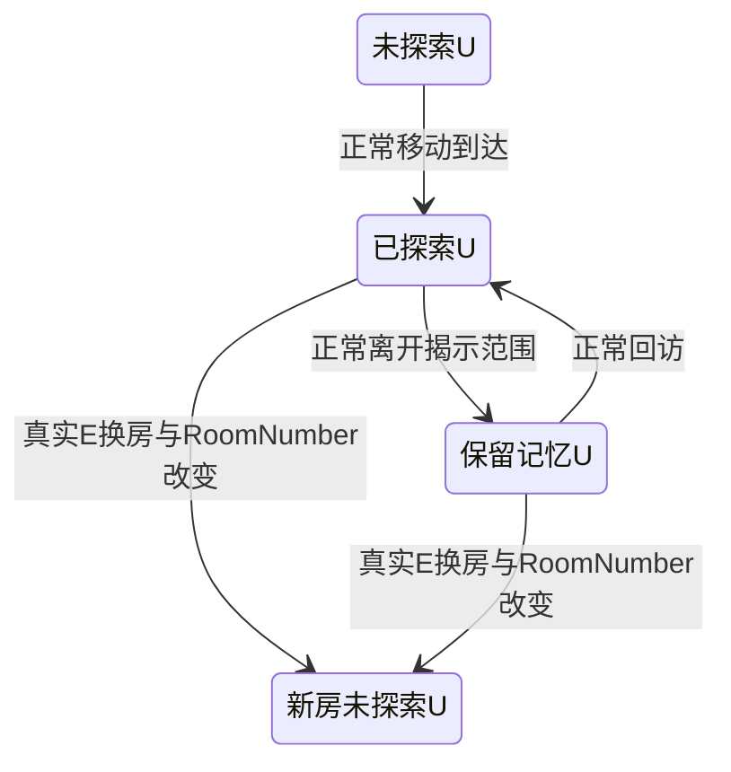

# EV-042 场景空间、探索记忆与新骑士外观验证计划

日期：2026-10-15。状态：只读核查与后续专门录制方案，未运行 UE/UBT，未修改 HUD、Actor、Probe、capture 脚本、原22项/新增Dodge4项/技能边界2项测试。本文件中的新profile及getter名称均为助手建议，尚未实施。

## 事实、判断和边界

- 根代理转达EV-042：人物/怪物缩小、场景扩大、边缘未探索迷雾、主角改为遮脸盔甲骑士。具体缩放、相机与揭示半径仍由本轮候选画面确认，不新增角色属性或战斗机制。
- 已读 `F:/Ourgame/UnrealGame/Source/CodexDungeon/DungeonRoomLayout.h`：唯一运行中心边界为 X[-1350,1350]、Y[-420,440]cm。角色、技能前踏和石骑运行 Frame 已读该共同来源；出生点/血量/动作时间/掉落/旧出口条件未随扩大空间改变。
- 本次核查时 HUD 仍为固定Ground投影与房间图形，公开只读接口只有石骑声音请求计数，尚无探索格、记忆或相机诊断。根代理正在实施新的HUD；本报告不把计划字段写成已有功能。
- 真实 `2026-10-15_军剑技能轻甲单石骑状态驱动运行_v001/index.json`：profile `first_unit_swd_skill_lgt_stone`，19项运行检查通过、419原帧，自动状态仍 `captured_pending_visual_audio_review`。后续 `-FirstUnitSkill -Version v002` 可以复用同19项玩法逻辑，但新环境、探索、缩放和外观须另给证据，不能由旧19项推导。
- 新圆盔骑士档案 `2026-10-15_圆盔骑士新基准_v003/index.json` 标记 `work_in_progress_not_runtime_accepted`；目前是新基准及idle制作阶段。只有idle6就绪时，只登记“新骑士待机6帧候选已接入/待审阅”，走路、三段主攻、技能、跳/落、受击、死亡、闪避仍逐clip记录实际旧版/fallback；equip借用idle也不能记作新换甲动画已完成。

判断：探索必须有按房间和世界坐标保存的真实记忆。固定边缘暗角、只随相机移动的黑色边框、仅当前位置周围的临时聚光，均不足以证明“走过以后记得”。探索显示不应反向授予战斗/移动、刷怪、伤害或来源验收。

## 最小正常输入流程

未来建议独立 `RoomExploration` profile/主题，复用可信预热/主混音/原件/时间戳机制；不替换FirstUnitSkill的19项名单，不在当前脚本上偷偷增加新验收含义。可以在一次自然完成的单石骑战斗之后继续环境段，或另开明确标记的环境开发场景；禁止直接Kill、无敌、回血、改RoomNumber/NextRoom或写探索mask来造结果。

| 阶段 | 正常输入与状态前提 | 必须读取/保存的实际证据 |
| --- | --- | --- |
| A 初始未探索 | 真实录制起点保留待机画面；等HUD首次更新稳定，选两个室内合法世界格U/V。U在当前揭示半径外，V在计划往返路线的揭示范围外。 | RoomKey、ResetSerial、GridInfo、玩家XY、U/V格ID、两格Explored=false；TotalCells>ExploredCells且后者>0。初始脚下已揭示是正常行为，不要求全图计数为0。 |
| B 移动揭开 | 正常W/A/S/D，按真实GroundPosition到U邻近区域；不靠固定秒数推断到达。停止后等HUD更新覆盖这次实际位移。 | U由未探索变Explored；ExploredCells增加；Revision增加；V仍未探索；截图能看见原先遮挡区域及真实角色脚底。不能一次移动就全图解锁。 |
| C 回访/记忆 | 正常输入离开U到B点，使U在当前揭示范围外，再返回已走过区域。最好B点仍能在画面看到U，便于直接比较记忆雾与未探索雾。 | 离开后U.Explored持续true，若有Visible状态则U.Visible=false；记忆雾与V未探索雾有实际差异。返回时同一RoomKey/CellId保持，ExploredCells不减少；只经过已揭示路径时不凭时间/屏幕位置重置mask。 |
| D 换房重置 | 先通过真实战斗清房；正常方向输入到当前真实出口区，fresh E交互，实际RoomNumber变大。 | 等HUD RoomKey跟上新RoomNumber且ResetSerial只增加一次。新出生附近会立即揭示，远U必须回到未探索；旧房的格记忆不能穿到新房。保存新房第一帧、出生XY及新格样本。 |

U/V须从实际grid中选，使用格中心并留cell半对角与揭示软边余量；不能选房间外或装饰墙外的“永远黑”像素。选不到合法未探索格，应报 `no_unexplored_interior_cell`，说明当前半径/房间配置没有可验证的探索空间，不能修改诊断结果蒙混。

当前普通出口依据是GameMode的 `bRoomCleared && X>600 && |Y|<100`，E还要求存活/落地/可起普通动作。扩大的房间并未自动把出口迁到MaxX；录制必须用真实交互条件，HUD门标应与它同源。按E时应离旧coin/potion/axe超过拾取范围，避免拾取优先分支抢走换房输入。若新的出口合同由根代理调整，以实际已接线规则为准，不凭画面门位置宣称已换房。

路径耗时用实际速度与距离估计，推进按真实位置/记忆状态。原FirstUnitSkill仍有30秒fixture截止；探索往返加换房若超出预算，应另设明确的独立profile与时限，不放宽旧19项、录音同步或偷偷延长旧录像。所有失败保留新版本，不覆盖v001。

## 建议给HUD的最小只读诊断

名称可按根代理实际实现调整；必须 `const` 且不触发揭示/清空/相机移动。Probe读取本身不能把被测格标为探索。诊断值来自实际用于Draw的状态，而不是另一份用于QA的预期mask。

| 拟议读取项 | 用途 |
| --- | --- |
| `GetExplorationRoomNumber()` + `GetExplorationResetSerial()` | 确认实际显示房间与Game.RoomNumber相符，换房只重置一次。RoomNumber不变时重绘/录像不能清记忆。 |
| `GetExplorationGridInfo()` | 返回实际BoundsMin/Max、GridWidth/Height、CellSize、揭示半径/形状及布局版本，支持选合法格和解释计数；直接读DungeonRoomLayout同源边界。 |
| `GetExploredCellCount()` / `GetExplorationCellCount()` | 揭示增长、同房不减少、并非全图一次亮；初始部分揭示与换房初始揭示均能量化。 |
| `GetExplorationRevision()` + `GetExplorationUpdatedSimTime()` | Revision只在真实mask变化时增加；等一次实际HUD更新，而不是以render frame数或盲目sleep判断完成。阶段开始记录目标SimTime，之后等UpdatedTime覆盖该固定时点，不能每tick把目标不断往后推。 |
| `GetExplorationCellState(WorldXY)` | 返回InBounds、稳定CellId/CellXY、Explored；若渲染有三态，再返回Visible/实际FogClass或Opacity。记录U/V的相同世界格，避免把不同屏幕像素当同格。 |
| `GetCameraGroundCenter()` + 实际投影scale/viewport | 验证相机滚动后世界格身份不变；计算B点能否把已探索但不在当前揭示范围的U仍留在视口内。 |
| `GetLastRenderedHeroFrame()` | 返回实际Draw使用的TexturePath/assetVersion、ActorAnimation、实际BodyClip/FrameIndex、fallback原因、投影脚点与像素尺寸；分辨idle v003与其他旧动作，核对新身份、缺帧和缩放。缓存里有纹理或“requested v003”不等于实际绘制。 |

若只实现两态“未探索/已探索”，Visible不是强制新玩法；保持已探索mask已经能证明记忆。若实现三态，建议未探索最暗、已探索但当前不在视域内较暗、当前可见最清楚；具体亮度与范围为视觉候选，不在本计划中暗定参数。

RoomKey至少区分当前Run会话和RoomNumber。当前RestartRun可能重新回到RoomNumber=1，HUD对象仍在；仅比较数字1会把上局第一房记忆带入新局。若尚无RunId，可用明确的新局epoch或本次Player实例身份作为临时开发诊断，并注明其不是D13持久身份。当前回访记忆只覆盖本局运行内，同步保存/读档尚未验证。

## 最小图形验收

保存同一运行四个关键原帧：初始U暗、到U揭开、离开后U记忆/V仍暗、新房同世界格U重置。每帧旁边的报告保存真实RoomKey/CellId/XY/相机/计数，避免只凭四张“看起来更亮”的图判断。若U离开视域就完全移出屏幕，先用诊断证明记忆，再记录视觉证据缺口；不能把再次靠近时的聚光冒充离开期间的记忆显示。

人物/怪物缩小需在同1280×720、同clip/姿态与相近相对站位下比较：实际不透明身体像素高/视口高、Draw尺寸、身体/武器/地面影子/落脚点/预警/描边的共同投影关系。只缩纹理quad而未处理透明padding可能仍看不出一致比例；UI文字不要随世界人物一起无意缩小。新骑士待机至少读到6个实际frame索引/实际TexturePath，并核对头盔遮脸、无旧脸闪回、左右仅一次镜像、脚底锚点与握点。

所有动作继续逐clip记录：idle6通过不覆盖walk/primary1..3/secondary/air-primary/jump/fall/land/hurt/death/dodge。FirstUnitSkill v002即使19项逻辑全PASS，交付范围也应写“新骑士idle候选＋其余旧动作候选/占位、扩大房间候选、探索另待专门验证”，直到实际图帧和诊断共同证明更多clip已替换。

本方案没有增加探索奖励、敌人刷出/隐藏规则、开地图道具或联网规则；画面迷雾与这些玩法需分别定义与验收。根代理后续决定专门profile实现，本文件不授权当前Probe/PS变更。

## 2026-10-15 后续明确授权与实现冻结

上文保留只读计划形成时的源码状态。根代理随后已接入HUD只读诊断与世界网格Reveal核，并明确授权独立 `-FirstUnitExplore`。本代理此阶段仅改Probe.h/.cpp及capture脚本；没有改HUD、Actor、GameMode、Driver或测试，没有启动UE/UBT。下列为已写源码和只读验证，**新Explore尚未构建/实录，不能登记26 PASS或探索视觉验收完成**。

实际新增参数为 `-FirstUnitExplore`，启动时包含 `-DungeonFirstUnitProof -DungeonFirstUnitSkillProof -DungeonFirstUnitExploreProof -DungeonStoneKnightPreview`。运行profile为 `first_unit_swd_skill_lgt_stone_explore`，独立档案主题为 `军剑技能单石骑探索记忆换房运行`，展示副本为 `first-unit-swd-skill-exploration.mp4`。需要候选图时另外明确 `-CandidateSprites`，默认仍为false；实际纹理路径由HUD最后一次Draw字段记录，不能以请求标志替代真正绘制。

独立合同保留原FirstUnitSkill全部19项和战斗30秒截止，完成空攻自然击杀、左行、落地地面J全动作后，才追加下列7项；新profile整体最多45秒，超时保留FAIL，不回写旧版本。旧benchmark、FirstUnit、FirstUnitSkill的名单/时限分别保持9/16/19与原11/30/30秒。

| 新增唯一检查 | 真实正常输入与读数 |
| --- | --- |
| `explore_initial_u_v_r_unknown` | 首次稳定HUD状态时，U/V/R的Memory与CurrentVisibility严格0，计数>0，Game/HUD同房；初始脚下正常Reveal不要求全图0 |
| `explore_normal_a_revealed_u_r_and_memory_grew` | 清房并等待全部真实动作结束，正常A走到U附近；U/R均Memory=CurrentVisibility=1、真实count增长、同房ResetSerial不变且count从未下降 |
| `explore_normal_d_retreat_kept_u_memory_outside_visibility` | 正常D退到X约-300；U当前可见度严格0但记忆仍1，R仍1、count不减少、房间与Serial不变 |
| `explore_unvisited_v_stayed_unknown_through_retreat` | 同次退回时V的Memory与CurrentVisibility仍严格0；之后去出口可能正常揭示V边缘，不把该阶段扩大为V永远未知 |
| `explore_fresh_e_changed_room_and_hud_reset_once` | 正常D到真实旧出口X>610、absY<100，落地且完整动作结束后只按一次fresh E；真实Game.RoomNumber+1、HUD跟随新房、Serial恰+1、同一角色真实出生(-580,0)，HP/金币不改 |
| `explore_new_room_cleared_r_and_u_matches_fresh_visibility` | R旧记忆1在新房严格归0；U旧记忆1变成新出生位置真实Reveal值；新房count>0且小于旧往返累计count，不能要求新房脚下没有自然揭示 |
| `explore_completed_within_45s` | 新房保持正常idle至少1实际模拟秒，继续保R=0/同一新房Serial/原HP/真实出生位置，随后自然停录；整体wall<45秒 |

所有点由共享 `DungeonRoomLayout` 边界推导：U=(MinX+3×64,MinY+7×64)=(-1158,28)，V=(MinX+40×64,28)=(1210,28)，R=(MinX+2×64,28)=(-1222,28)。它们是实际Memory网格的精确顶点，不混用渲染三角网或屏幕坐标。

关键前提修正：实际NextRoom出生为(-580,0)，Reveal使用620×280椭圆、.68以内全亮、外环平滑衰减。U的归一半径约.9376<1，新房应自然揭示为约 **0.09922745344099626**，所以原计划/根提案的“新房U必须0”不成立。已向根报告并获确认：保留U作旧1→新出生Reveal值见证，另用更远的R作严格0见证。不改出生/半径/阈值；U只与公开纯核对真实新出生的VisibilityAt结果作1e-9数值比较，R仍严格零。

每Tick保存Game/HUD房间、ResetSerial、ExploredVertexCount、U/V/R记忆与当前可见度、实际相机中心、实际最后Draw主角纹理路径与sprite size。关键采样另存 initial、A揭示、D退回、E前旧出口、新房首次Reset和新房idle结束；完整实际纹理路径去重列表随 `first_unit.exploration` 写报告。读取方法没有Reveal/Reset副作用。换房若未发生/HUD未更新，最多等待2实际模拟秒后FAIL，不直接NextRoom或写mask救场。

录制机制最小例外只有一行：`StartRecordingOutput(this, bFirstUnitExplore?64.f:(bFirstUnit?32.f:12.f), nullptr)`；64秒是Explore预分配提示，不是输出伪造长度。其余五个录制函数逐字相同，BeginAudioCapture除该表达式外逐字相同。PS的WAV完整解码/原件与规范副本PCM相同receipt、音频控制恢复、预热回执、时间戳和同步判断片段逐字相同；首帧≤100ms与音轨-wall≤150ms门不改，无重剪PCM、拉伸、增益或离线音轨替代。

已完成的本地验证：PowerShell AST解析通过；26个C++声明名唯一且与PS名单相符；每个新增检查有一次实际Check写入点；阶段enum与成员名无遮蔽；探索分支无SetActorLocation/ResetFighter/ApplyCombatHit/NextRoom/TryBeginWeaponSkill/Reveal/Reset调用；直接逐行扫描所改文本无尾随空白。git diff在当前未跟踪文件上没有可评估差异，不能替代该显式扫描。更新脚本只读复核真实旧档案：benchmark v005=9项/329帧、FirstUnit v002=16项/429帧、Skill v001=19项/419帧，三者全部runtime/audio/sync通过，未改任何旧原件或索引。上述只读回归不能代替新Explore实录。

当前视觉范围仍是新圆盔**仅idle6候选**；其他动作实际保留更早候选/fallback，新profile记录实际Draw路径供根抽帧审查。26项即使将来通过也不等于整套新骑士动作、像素缩放、混音听感、实际来源或D13存档已完成。两项技能连续时序/LOS真实业务RED见独立 `swd-skill-adapter-review.md`，该公开缺口也不能因本路线正常通过而关闭。

冻结源码SHA-256：Probe.h `E8C2A139EDDA263FB7E2A7B760CA62703E0D68349D94B0E3993182765FD65F1E`；Probe.cpp `6064034A53F6A591D9102A4A1FCBFCC1B24B0E1B3862327159E681F14218F513`；verify-content-combat.ps1 `80CBA9E09876BAB3AE59A4ECFB5406947D82DBCCB2A829D83E9C92D192BEABC6`。
