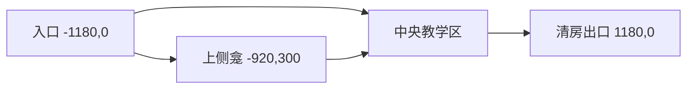

# EV-042 探索布局与真实可发现物：只读审计和最小接线建议

2026-10-15，Asia/Shanghai；ranged_review。仅检查现有源码和D07/D08设计，未修改Source、美术、战斗/经济数值合同，未运行UE/UBT。下述坐标和布局是助手建议，尚未建图或实际验证；不增加用户事件，不改变正式0/15。

## 事实

1. `UnrealGame/Source/CodexDungeon/DungeonRoomLayout.h:8`定义实际中心边界X[-1350,1350]、Y[-420,440]，2700×860cm；D07 `docs/design/dungeon-v1/common-rules.json`建议普通房半值1400×450，和当前扩大量级接近，不能说扩大本身未实现。
2. 当前普通出口不是统一的X610：`DungeonGameMode.cpp:1436`判断X>600且|Y|<100，`DungeonHUD.cpp:320`画在(665,0)；`DungeonContentProbe.cpp:823`的610仅为旧Explore正常步行停点。因此角色进入右半宽区域后就能E换房，X665之后至1350的场地不是继续前进的必要路径。
3. `NextRoom`仍把同一玩家移到(-580,0)，`SpawnRoom`普通原型的三敌固定在(180,-100)/(390,95)/(580,-30)，石骑显式预览在(300,0)。扩大场地没有同步建立遍及新空间的入口、路口、侧龛或出口布局。现有墙地面按world256/96等格重复绘制；重复空地问题不能只靠再加宽边界解决。
4. HUD `UpdateRoomView`创建并Reveal同一探索网格，横向镜头跟随，`DungeonExploration.h`的620×280椭圆在0.68内完全可见、外缘平滑衰减；同房显示记忆单调保留，房号/RunRestart变更才重建。当前网格没有LOS墙遮挡。历史Explore-v006的26项确实覆盖正常走动、记忆和旧出口换房；它不覆盖发现机关/支路/正式奖励。
5. GameMode当前没有场景发现对象/已调查状态或独立路线布局清单。旧`Pickups`由真实敌人死亡生成，在雾之前绘制；真实装备源由`DrawEquipmentSources`按当前可见度>0.05显示，并有80×40cm/LOS及真实E动作接纳。单纯揭雾不会新增装备、发现记录或收益。
6. Bound Run的`DungeonFighter.cpp:947`正常E直接调用`TryInteractEquipment`；`DungeonGameMode.cpp:1393`的`TryInteract`对Bound也直接转入装备并return；`TryInteractEquipment:200`无source即NoTarget，没有普通出口路由。新场景如果使用真实装备实例，只搬门图仍不能走通换房。此结论来自源码，不声称已作新运行复现。
7. D07主路免费、地面可达，不需跳跃/随机钥匙；可选支路可跳过并汇回，不绕Boss；转场走廊最窄160cm且不作为战斗生成/锁清地点。隐藏房均有免费回程。D08普通房奖励按整房有限清单固定，N03保证一个装备地面来源；支路不自动再发药/装备。首次发现+2仅针对既定H01唯一事件，必须实际走完路径并完成发现点交互，揭雾/到门/付票都不发。REG01-H01是可选Boss密窟及20金币入场，不应把普通壁龛冒称该H01或随意发碎片。

## 推理与最小方案

当前缺的是“走过去会找到什么、怎样返回/继续”，不是探索网格数量。建议先做一个独立显式SceneExplorationPreview布局：同一实际大房间内保留一个已有单威胁教学遭遇、一条免费主路、一个绕障可进入的侧龛和一个真正位于右端的出口。侧龛物件必须来自GameMode实际对象/来源，E改变实际归属或调查状态；HUD只读显示，走近、Reveal或DrawHUD不能代替交互。

为避免扩大遭遇/经济范围，第一轮不增加敌人数、不做三波、不加陷阱/开锁/收费门、不把所有D07节点塞进同一房。空间关系如下，仍全部在当前bounds内：

| 区域/对象 | 建议世界坐标或范围（cm） | 用途与约束 |
| --- | --- | --- |
| 新布局入口/回程落点 | (-1180,0) | 与左边界留170；普通转场不回HP/Focus/Ammo/CD，继续同一玩家和Run；仅新布局使用此点。 |
| 主路与教学战区 | 主线Y约0；战斗留X[-650,600]、Y[-220,220]的开阔带 | 沿现有单敌预览验证；保持攻击时轴/范围/数量，不在过渡走廊放敌。实际body/charge与Y逃生仍须跑图。 |
| 侧龛挡墙 | 一个真实WorldStatic矩形，X[-1100,-700]、Y[60,160] | 阻挡直穿，迫使地面绕行；左侧至bounds余250、上侧至MaxY余280，纸面均大于160。按实际body连续扫掠验最窄处，不用贴图假墙。 |
| 侧龛可发现物 | (-920,300)，绕挡墙西端或东端进入 | 入口(-1180,0)到此点的探索椭圆归一距离>1，初始不可见；到侧龛后才能读清物件并正常E。不能在隔墙range内显示/提交交互。 |
| 右端出口 | 中心(1180,0)，以布局对象定义局部交互区 | 门与HUD使用同一坐标；过渡通行宽至少160，具体交互范围沿D04既有合同，不再用X>600半平面。X665附近不得仍触发该新门。 |
| 视觉路标 | 左侧入口、侧龛开口、中央区、右侧门各一处 | 用现有材质/简单几何做可审阅占位；暂不生成新美术。主路方向应能辨认，侧龛提供可选绕行，不需要扫遍每个角落。 |

侧龛首先承载一件明确登记的真实装备source以验“找到→E取得→原处消失→实例保持→离开”的玩法。开发预览可明确标为固定QA来源，走现有`RegisterEquipmentSource`和正常E/满槽选择/旧物落地；它不是正式掉落验收。正式N03采用同一摆放位置时，应接D08既有那一个保证装备来源，清房后只解析一次，物件/InstanceID固定，不另加一件“探索奖励”。新布局若被认定为N02，不能套N03保证；改用无收入的调查牌验证发现，真实药瓶仍走N02唯一来源。不能以放置方便为由修改房间职能/收益。

纯调查物可只显示本房出口方向与“已调查”，不发金币/碎片/钥匙，也不挡清房；需要Run/Room/Object稳定ID与一次调查latch。正式隐藏入口、H01发现点及首次奖励是下一层，须有实际支路房和D08唯一事件事务才能启用，不能借当前HUD雾记忆充当账号发现状态。

## 精确接线位置与边界

| 文件/入口 | 必要变更建议 | 权限/回归边界 |
| --- | --- | --- |
| `DungeonRoomLayout.h` | 在既有bounds外形成可查询布局记录：LayoutID/版本、Entry、Exit/交互区、障碍盒、发现对象anchor；由GameMode选布局，HUD/转场/Probe只读同一记录。 | 当前常量bounds不需再扩大；旧Explore profile保留Legacy布局/旧坐标，以独立新profile验证新场景。 |
| `DungeonGameMode.h/.cpp`：`SpawnRoom`、`NextRoom`、`TryInteract` | 新布局只在显式配置启用；实际注册障碍、来源/调查物并保存Room归属。转场取布局Entry；普通出口由同一布局局部区+清房/存活/落地待机/路线许可接纳。E统一解析装备/场景对象/门，成功消费一次fresh edge。 | 保留真实装备selection优先级与满槽确认，不让同一次E既拾物又过门；有近物且接纳失败需明确提示，不悄悄换房。免费出口不能照搬付费设施完整安全谓词而额外禁DoT/旧弹；同点致死仍优先。 |
| `DungeonFighter.cpp`：`UpdatePlayerInput` | Bound E也进入统一上下文路由，装备动作与UI确认仍走现有API。 | 不直接改weapon/HP/位置来模拟结果；不打破Q、T、闪避、受击取消或原52。 |
| 建议新小模块`DungeonSceneObjects.h/.cpp`（若仅一物也可先GameMode私有记录） | 管理对象StableID/RoomID/种类/位置/一次调查或来源绑定；查询不分配ID；交互校验与提交在GameMode/真实Run事务。 | 不建立第二装备库存/HP权威；不调用DrawHUD推进游戏，不从雾透明度触发奖励；尚未D13持久化则明确只有本Run内存。 |
| `DungeonHUD.h/.cpp`：`DrawRoom`、`DrawEquipmentSources`、`DrawHUD` | 出口取布局anchor，显示可发现物/已调查状态；实际墙和道具按groundY进同一深度排序，物件/标签在雾外不泄漏。探索记忆显示可保留现有纯网格。 | 墙不只是绘图装饰；当前雾没有LOS，若本轮不新增遮蔽算法就明确此边界，用真实视线/交互range防隔墙调查；不宣称遮挡式战争迷雾完成。 |
| `DungeonContentProbe.*`与`verify-content-combat.ps1` | 新独立正常输入场景profile，读取布局对象，不再写死610；覆盖主路/侧龛/返回/真实E/右端换房。 | 旧26的意义/来源保留，不把它改名冒充新布局已过；新checks数以落盘名称/实际报告核对。 |
| `docs/design/dungeon-v1/*`、`economy-v1/*` | 本轮只读取现有合同。需要新增正式布局绑定时记录LayoutID/版本/节点角色与唯一奖励来源，不修改价格/概率/预算。 | D07/D08当前`design_only`；源码demo通过不能升级为完整七节点/经济/存档完成。 |

真装备Bound路径目前没有退出路由是新场景必须先补的功能；否则布局看似可探索但终点不可用。正式奖励源尚缺则先把固定物件标QA，不假称它是D08自然掉落。房间清除也不能仅因当前敌数组为空就放门；若未来加入D07有限后续组，必须把未触发/排队义务计入，否则会出现清房后再刷怪。

## 运行验收建议与成本

实现顺序：冻结新布局与统一交互route的可编译接口→真实新profile/必要Actor反例RED→最小接线→root统一构建和实际正常输入录像→F/E保留后双向审看。此计划本身未执行任何新profile。

- 从新入口正常走向门，初始看不到侧龛物件；主路不要求跳跃或金币，不把侧龛选取作为唯一过门条件。
- 正常绕真实挡墙进入侧龛，先观察真实物件再E；满槽显示真实确认，取消不丢物，成功只有同一实例换归属一次。若调查物则一次latch/无经济奖励；重复E/往返不重生或重抽。
- 回到主路仍保同房探索记忆和源消费状态；NPC/装备信息不在未发现雾区提前悬浮可读。
- 清房前门封闭，未清仍可免费走到必须触发区域；X665的fresh E不能跳新房。实际到(1180,0)后fresh E一次换房，出生在新布局入口，旧Room物件不串房，角色资源/CD继续。Bound和旧unbound路径分开验证。
- 实际连续扫掠玩家/现有敌人通过所有路径，侧龛非战斗区没有贴脸生成；石骑冲锋/蝠低位如放入此布局要另验动态反制，不凭纸面宽度保证安全。边缘雾、门与交互物一起拍到，不能只证明网格变亮。

最小新增成本是一个布局记录、一个真实障碍、一个实际对象/来源、E路由和专用proof；不需要本轮新图或paid生成。主要工程风险是旧默认入口/门硬编码、Bound路由缺口、HUD fog与Gameplay权限混淆、物件一次性来源/D13缺失，以及把可选物件误变成必经经济门。路线总步行长度和游戏节奏尚无实际计时，不能给出已证通关时长或正式场景完成判断。
