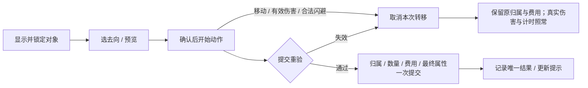

# 携带、拾取、替换与交互系统设计 v1

2026-10-13，Asia/Shanghai。模块D-04，承接EV-022“继续”及D-03最小携带接口。状态：**设计初稿，未制作、未试玩或逐条确认。** 本轮槽位、距离、动作、输入及自动拾取均为助手方案，不是《失落城堡》的精确机制说明。

## 1. 事实、推理、风险与选择

**事实**：现有33武器/12甲、36道具及属性/战斗/使用规则已有设计；原型的简单E拾取不能覆盖完整库存、槽满替换、购买、暂停整理与事务。用户要求先整体设计，当前不新增玩法代码或工程资产。

**推理**：沿用有限槽位，将“选对象/选去向”“真实动作”“归属/资源提交”分开。玩家应在提交前看清得到什么、失去什么，失败不会因界面点过确认就提前丢物或扣钱。

**风险**：自动选最近目标会在拾取消失后误进出口；暂停瞬间换甲能规避动作代价；先卸旧甲再装新甲会错误截生命；部分买入却扣整份价格、物品/永久资源分两次记账会造成损失或复制。两快捷槽只限制随身携带，原房地面仍可留药；它不是彻底禁止囤药的证明，供给/价格/地图进退需要D-07/08/14共同约束。

| 方案 | 取舍 | 结论 |
| --- | --- | --- |
| 有限槽位、地面留物、显式替换 | 取舍清楚、菜单规模小；要处理余量与遗留提示 | 沿用D-03建议，作为本轮方案。 |
| 增加储备背包、重量与整理格子 | 能保存更多战利品，但增加囤积、UI/手柄和经济成本 | 本轮不增加储备包/负重/仓库。 |
| 拾取后自动卖出或换成资源 | 清地快，但改变金币经济/永久成长并可能误卖 | 本轮不采用售卖、分解或自动兑换。 |

详细玩家流程：[16个交互流程与界面状态](docs/design/inventory-v1/01-交互流程与界面状态.md)。验收初稿：[24个边界案例](docs/design/inventory-v1/02-边界案例.md)。

## 2. 携带容量与身份

| 内容 | 容量 | 特殊边界 |
| --- | --- | --- |
| 武器 | 两槽，一槽一个实例 | 同定义的两把枪可以分别持有，各自弹匣/附魔/强化/武器技CD独立；仅当前槽贡献武器属性。 |
| 身体防具 | 一槽 | 不叠穿；可空甲，恢复裸装基础再加有效遗物/药剂。 |
| REC/BOO/THR/TRP | 两快捷槽 | 一槽一个ID，逐件上限1～3；同ID只能一个槽，无槽外储备。 |
| PAS遗物 | 三槽 | 三个不同ID；重复ID只能显式交换已有同ID所在槽的物理实例，不增加效果或触发预算。 |
| FUN功能物 | 每ID一个独立记录 | 六种ID各按D-03上限，不占快捷/遗物槽；剧情旗标另存。 |
| 金币/局外碎片 | 资源账本 | 不占物品槽，不手动丢成可交易物，不由装备/道具兑换生成。 |

每个可转移对象有稳定定义ID、实例/堆栈ID、位置/归属和版本。一个活实例只属于一个槽、一个地面对象或一份商人物品；不能同时在手上和地面。数量为正整数，0量对象移除并保留已提交事件记录，旧ID不复用。

新生成武器初始弹匣按v1，商人商品在库存生成时已确定实例/随机结果；取消查看/购买不再生成满弹新副本。旧物换出/丢弃后仍是原实例，不能变成新生成满弹武器。角色共享CD、元素槽、使用锁、遗物每房预算不存进可清零的新物品副本。

## 3. 选择目标与货币拾取

### 3.1 E目标

落地且对象已在可拾取地面状态，候选须满足`abs(dx)≤80cm`、`abs(dy)≤40cm`，且角色至交互点无实体墙/闭门遮挡。此处是矩形候选区域，角点也有效；不是用归一化距离再裁成椭圆。物品不必在朝向前方，掉落图大小不放宽范围。

初次选取按类别优先级**携带物→容器/NPC/设施→出口**，类别内按`(dx/80)^2+(dy/40)^2`、稳定对象ID排序；满额/重复/暂不安全的物品仍可被选中查看拒绝原因，不能因它不能拾取就把同次E转交出口。Tab循环全部候选并显示序号，目标高亮后保持其ID，不因另一物品更近自动跳转。

目标离范围、被遮挡、移除或版本失效时清锁并提示；该次E不自动执行其他目标。下一次新输入才选取新对象。只对当前显示对象执行，按住E不自动连拾/连续过门；无目标只提示，不创建动作。战斗动作中的E请求不缓冲到后摇结束。

### 3.2 金币与碎片

普通地面金币/碎片在玩家**存活、本局活动、落地**且`abs(dx)≤60cm`、`abs(dy)≤30cm`、无墙/闭门遮挡时自动收集，不要求待机，不打断出招/短甲增益/站定恢复；空中不收。暂停不处理自动拾取。先处理同点伤害/死亡，再对仍活玩家处理收集。

一次唯一拾取事件原子完成“地面物移除＋本局钱包/永久碎片账增加”；碎片依D-01即时安全入账，结算仅展示、不再加一次。重复事件返回已提交结果。Boss保证碎片/首次奖励沿D-01独立事件自动入账，不再生成可重复领同奖励的地面物；可有无奖励资格的展示效果。

币值/碎片值为来源配置的正整数；本轮不定经济上限、价格或掉率。收集不与道具快捷槽合并，不能因槽满丢失资源。

## 4. 选择、动作与提交

### 4.1 两个交互层

地面选对象/选槽浮层**不暂停**。方向键导航，Enter确认，Esc取消；WASD作为移动意图关闭浮层，合法Shift可关闭并闪避。新战斗输入可关闭纯选择层并按D-03优先级接纳一个合法动作；鼠标/键盘确认事件被UI消费，不能穿透成攻击。已经开始实际拾取动作后按本节中断规则，不能借浮层取消后摇。

第一次E打开替换选择，不把同一次E当确认；确认前显示目标/数量、目的槽、旧物去向和效果差异。纯查看不预占物品/金币/地面落点、不重算属性。确认后才开始动作，提交前旧归属/静态来源继续有效。

| 操作 | 动作时间 | 可在战斗中开始？ |
| --- | --- | --- |
| 地面武器拾取/替换 | 0.35s | 地面待机可；保留完整动作与中断风险 |
| 身体甲拾取/替换 | 0.50s | 地面待机可 |
| 遗物拾取/替换/移除 | 0.50s | 仅第5节安全条件 |
| 快捷道具/FUN拾取、补栈 | 0.25s | 地面待机可；不是使用，不触发药效/使用锁 |
| 快捷/FUN拆量丢弃、备用武器丢弃、快捷槽交换 | 0.25s | 仅安全条件 |
| 当前武器丢弃并切备用 | 0.35s | 仅安全条件，作为一个复合事务 |
| 身体甲移除 | 0.50s | 仅安全条件 |
| 商人购买并装入/替换 | 按所得类别对应拾取时间 | 仅安全条件，遵循D-01 |

所有动作从地面待机/站定开始；站定指无移动意图且实际XY速度≤1cm/s。前提交移动、有效伤害（包括DoT）或合法闪避可取消，目标变更/失效也取消。失败的Shift不取消操作。取消不改本次库存/费用结果，**不回滚期间实际伤害、恢复或自然计时**，不把CD截止改回开始前。

所有新增拾取/丢弃/购买/整理/换装动作启动即撤`ARM-LGT-002/003`条件移动增益，清`ARM-ROB-003`站定计时/停止20/s条件恢复；取消不恢复这些已终止条件。普通专注恢复按当前来源及最后消耗时间继续。自动货币收集和纯暂停查看不启动这类主动动作。

同一时点按“全部伤害/死亡→自然到期及其破韧→仍存活者合法恢复队列→自动货币收集→本次取消或库存提交→新的主动请求”处理。恢复读取提交前的装备来源与当时有效状态；例如续回恰好与换甲完成同点，先按旧甲治疗效率/HP上限恢复，再一次重算新甲来源。已发生有效伤害的取消标记不因随后回血而撤销。

临时属性在截止时刻即无效，数值查询先按`now<deadline`筛来源，不能等清理回调才失效。燃烧/续回的到期同点最后一跳仍依D-03执行后移除，不能在自然到期阶段先删掉尚待处理的合法末跳。

合法闪避/移动取消意图在本次提交之前检查，新闪避动作在最后阶段作为唯一复合请求执行；不能同点拾取成功又闪避。取消/失败时原归属不变，完成才提交。Q切换仍按D-02，不获得闪避取消权限。

### 4.2 槽位与堆叠

- **武器空槽**：优先放最低编号空槽，成功后沿v1切为当前武器。若双槽满，明确选当前或备用槽；推荐当前但不自动确认。替当前则成功时切换来源；替备用不激活，当前武器/属性保持。旧武器落地保留实例状态。
- **身体甲**：空槽装入，满槽预览旧→新并确认；旧甲仅成功后落地。移除则恢复无甲基础护甲0/魔抗0/韧性30/移动倍率1/专注12每秒等待1秒，再合并其余有效来源，最后实际专注消耗时刻不变。
- **遗物**：安全条件下优先空槽，满槽显式选替换；重复ID只能替已有同ID槽。换出不把角色同ID触发CD/预算移走，换回不刷新。
- **同ID快捷补栈**：只补其现有槽，取`min(地面数量,上限-现有量)`，余量留原地。现有已满则拒绝，不在另一空槽建第二栈；拿不下不自动喝药/丢掉超量。
- **不同ID快捷拾取**：无同ID时优先最低空槽；全满则显式选一个槽，旧整栈落地，取得新ID最多该槽上限，来源剩量留地。不把两种药混栈，不默认取代“较弱”药。
- **FUN**：同ID补独立记录至上限，余留地；没有槽选择和战斗快捷使用。功能服务消费仍沿D-03匹配/权限/次数与原子结果，不因拾取而直接触发。

整栈移动保留堆栈ID；部分转移保留来源ID/剩量，目的新栈用新ID；补入已有栈保留目的ID。每次记录源/目的数量变化和派生ID，保证总量守恒；并栈/拆栈不影响角色逐道具ID冷却。强化/附魔装备不是可叠数量的普通道具。

## 5. 暂停查看、安全整理与丢弃

**安全条件**：房间已清、无存活敌人、无有效敌对飞行攻击/活动危险场，角色无燃烧等持续伤害、落地、待机站定。寒缓可以保留。进入条件与实际动作起点、提交点均须重验，不能只看HUD“清房”字样。

I在单人可随时暂停查看合法面板，冻结同一本局时钟。战斗中只读；不能移动物品、丢弃或从面板立即用药。安全时可选一个整理意图（快捷槽交换、丢弃/拆量、装备移除等），先预览，再明确选**“返回游戏并执行”**。I/Esc普通关闭不执行未确认选择。

已确认请求只存操作/源槽/数量/对象版本，不预占物/钱/落点、不应用属性。恢复后首个逻辑步先处理伤害/死亡/自然到期，再重验安全与对象；成功才开始第4节真实动作。若有新移动/战斗输入，或关闭时仍有其他游戏键按住，则取消计划，让后续新输入按规则处理；不与计划同时执行第二动作。失败清计划并解释，不等待条件变好后自动执行。旧按键事件清理，UI消费的键须释放再按才能作为游戏请求。

手动丢弃不收费但不等于瞬间操作：快捷/FUN只能选整数1～当前数量，武器/甲/遗物按实例整体；货币/永久旗标不能丢弃。丢弃普通数量不抹冷却；丢当前武器且有另一武器时，0.35s后原子切备用并落地旧实例。没有裸手攻击设计，**最后一把武器禁止手动丢弃**，仍可免费替换为地面/购买武器；这是通用携带边界，不依附魔好坏锁装。

地面物为非阻挡物，可叠在同一合法点并通过Tab选择，不制造阻路墙。换出/丢弃的落点先按玩家脚底，再依固定偏移`(±24,0),(0,±16),(24,16),(-24,-16)cm`寻找房内可达无墙/闭门的地面；预览/提交均重验。无合法落点则整笔拒绝，不把旧物销毁或塞进隐藏背包。地图必须提供正常可放物的站位；D-07明确禁止落物区域。

## 6. 完整归属事务与属性重算

每笔操作有OperationID、源对象/源槽版本、目的槽版本、转移数量、旧物落点、必要报价/券/设施次数。开始动作不改变归属；提交点在同一事务内重验角色/范围/视线/安全（若要求）、对象/槽版本、数量/容量、合法落点和服务权限。

成功一起提交“源移除/减量→目的装入/增量→旧物落地→必要金币/券/次数变化→最终属性→事件结果”。重复OperationID返回已提交结果，不再执行；失败无库存/付费提交，不重抽商品/奖励。实际程序的保存/崩溃恢复方案交D-13，本设计不宣称存档已经实现。

**先构建完成后的完整来源集合，再只重算/截断一次。** 例如旧甲HP上限125、当前120，换到另一件上限同为125的甲后仍120；不得先撤旧甲按裸身100截到100，再加新甲。若新最终上限90则截到90，随后卸下上限回100也不补回。韧性下降后仍保留累计削韧，达到新阈值可立即破韧；这是已成功提交的后果，不回滚换装。

原实例弹匣、武器CD截止、附魔/强化与攻击快照保留；旧弹沿D-02/03既有攻击快照，治疗效率/目标防御仍按实际时点。换出装备不重置角色闪避/元素/药剂CD、专注最后消耗/预算或遗物每房记忆。没有“重新拾起就新生成满资源”。

## 7. 商人购买、设施与出口

购买先选已生成商品和整包数量，再选合法去向、展示旧物落地/实际属性与费用/优惠；确认后走对应类别动作。金币以提交时当前余额校验，只要够付，不因期间自动捡金币而拒绝；报价、商品/源槽/券版本必须仍匹配，变化则拒绝并要求重新确认，不擅自加价。

**商品整包全接纳或全拒绝。** 与地面部分补栈不同，不能付整价只拿一部分，也不把剩余商品免费掉地。替换目的槽后仍装不下整包则拒绝；玩家可先在安全条件整理，再重新购买。商品/金币/券/设施次数/旧物落地一次提交，失败保原状态；重复确认不重复扣款。价格/品质/库存/服务权重仍由D-08定义。

同一购买最多一张匹配功能券，不能跨服务混抵或变负价；轮盘/强化/洗净等沿D-03对应权限和结果规则。取消后只退出选择，已提交随机结果/次数不能退款重抽。

出口须显式选中，不是拾取失败后的备用动作。普通免费出口要求房间已清、无存活敌人、角色落地待机站定、路线/门条件通过，**不要求整理用的完整安全谓词**：燃烧或旧敌弹存在时可以离开，但不会净化身上状态，且同点致死伤害/硬直先处理。需要扣金币/钥匙/券的可选入口额外要求完整安全条件，遵守D-01/03服务消费限制。

D-07提供通行条件、`returnable`及跨章/结束标记；未配可返回信息按不可返回处理。已知可逆、无地面物/房间飞行攻击、无身上持续伤害、无跨章/终局后果的门可直接通行；其他情况显示遗留对象/数量、未收金币/碎片、放弃的飞行攻击、持续状态和可返回性，Enter确认，Esc取消。确认时风险/路线/费用信息变化须重新展示并取得新确认，不能在刚出现新掉落后沿旧预览悄悄离开。

离开不自动卖出、装包或领尚未收集资源；已入账碎片不重复领取。所有武器飞行弹、投掷道具与部署物绑定原RoomInstanceID，离房清理未结算房间攻击/部署、不退已耗资源；不能把旧弹迁入新房打新敌人，确认页须包含仍飞行的武器弹。玩家身上燃烧/寒缓/续回/药剂剩余时间、装备实例与角色CD依D-01/03保留，过场冻结本局时钟。

若以后允许回到同一房间，恢复原房间实例/地面物/开启状态/CD/预算，不再生成奖励；界面未保证可返就不能承诺回取。跨章无法回取的留地物在确认中明确；本局结束仍按D-01清局内物与金币。

## 8. 输入、界面与生产接口

世界输入继续D-03优先级：闪避→跳跃→1→2→武器技→主攻→切换→装填→E交互；Tab只改变目标、不触发转移，不在动作中缓冲E。UI输入与世界输入分别消费，一个逻辑步只接纳一个主动请求。纯选择层、暂停查看、确认预览、进行中动作、失败提示的详细状态见流程文档。

至少显示：物品名/数量/稳定指向、已满/暂不安全原因、原始效果与当前实际变化/封顶、武器完整周期/距离/弹匣和武器技剩余CD、护甲/魔抗/HP/韧性/移速/专注、附魔正负及其等级、快捷共享锁/逐IDCD、遗物条件/预算、旧物去向、服务费用/优惠及出口遗留。用文字/符号识别好坏，不靠颜色；本轮不提供自动“总战力最佳”替换。

D-11补视觉布局、字号、改键、手柄具体映射/焦点与引导；D-12补拾取/换装/丢弃共用动作、声音与高亮。当前为文字流程，不等于界面或素材已制作。本轮不生成付费/图像/视频，不启动UE验证新系统。

## 9. 新旧关系、保存与验收

本文继承D-03容量和使用规则，补完D-04单人交互初稿；覆盖v1仅最近E/双槽满自动换当前的简化描述，加入明确锁目标/选槽及本轮货币自动收集。保留v1/v2与D-01/02/03原稿，不改写物品定义/数量/伤害/附魔。

旧“负附魔可免费丢弃/替换”继续指无费用/无诅咒锁；本轮补安全时机、动作、合法落点和最后武器保留。没有因为坏附魔额外禁用替换/洗净。D-03元解锁资格、角色共享状态与D-01资源/奖励规则继续。

保存至少需要RunID/RoomInstanceID、对象/堆栈ID与版本/归属/数量、当前武器索引、所有槽/账本、地面物/服务/报价/随机结果、已提交OperationID/PickupEventID、各CD截止和每房预算。未完成动作不能通过读档免费完成或重复退物；D-13决定保存安全点/恢复策略。未来合作的抢拾/预留/断线/共享归属另行设计，本轮单人原子接口不冒充联网方案。

设计检查覆盖容量/引用/动作参数/案例和守恒算术；未来仍要真实输入验证目标高亮、触达/遮挡、取消同帧、资源去重、暂停恢复、落点、旧弹和出口风险。检查报告：[validation-report.json](docs/design/inventory-v1/validation-report.json)。**文字流程齐全不等于实际可玩或易用。**

下一主模块D-05普通敌人与精英：按11武器家族、走位/跳跃/闪避、元素/削韧保护和道具反制设计敌人职能/招式/组合，随后D-06 Boss。

关联：[整体清单](整体设计清单与推进顺序.md)、[D-01循环](整体框架与单局循环设计.md)、[D-02战斗](玩家角色与战斗规则设计.md)、[D-03道具](道具与状态系统设计.md)、[属性附魔](属性与附魔设计总览.md)、[需求台账](项目需求台账.md)。结构化规则：[inventory-rules.json](docs/design/inventory-v1/inventory-rules.json)。
