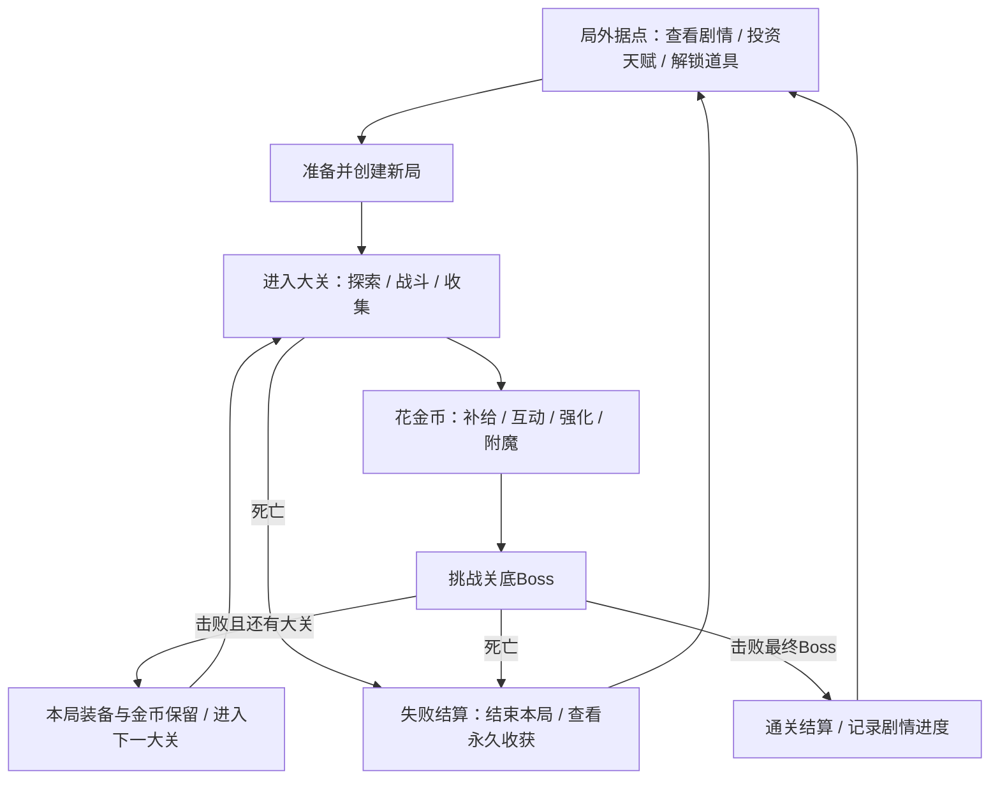

# 整体框架与单局循环设计 v1

2026-10-12，Asia/Shanghai。模块D-01。本轮依据EV-019细化整体框架，并给D-03、D-07、D-08、D-09、D-10、D-13提供接口约束。状态：**整体循环设计初稿已形成；规则待用户修订，未制作、未试玩验证。** 道具、敌人、Boss、天赋、经济的完整目录不在本轮冒充完成。

## 1. 用户明确要求与本轮建议

用户明确：整体流程参考《失落城堡》；局内获得物品、金币和收集物。金币用于局内道具、转轮、轮盘、商人、角色交互、隐藏地图、装备升级和附魔更新，增强本局战斗力。收集物用于局外天赋升级和特殊道具解锁。通过局内与局外逐步成长，越过多个大关、击败更强的小怪与Boss，推进剧情，最终通关。

以下为本轮助手建议，未视作用户逐项确认：采用一个局外据点界面；一局暂按五个大关搭框架、各有一个关底Boss；金币只属当局，收集物安全入账且死亡保留；失败从第一关开始新局，主线记录保留但不自动跳关。暂不规定单局分钟数、房间固定数量、天赋节点数量、关卡正式名称或金币价格。

参考方向按用户描述落实，本项目细则为原创方案，不用未核实的原作数值或机制作事实依据。

## 2. 判断：事实、推理与风险

**事实**：武器、防具、属性和附魔已有设计稿；完整整局、经济和永久成长尚未实现。用户此次明确采用天赋成长、内容解锁和多种金币互动，它们由此前候选方向进入已确认范围。

**推理**：单局提供快速变强、选择与风险；局外提供可累积的进步与新的打法。两类资源必须分别说明来源、用途、结算、死亡和退出规则，否则“成长”只是不断加数值，没有完整流程。

**风险**：永久增益过大容易把通关变成刷天赋门槛；掉落池不断扩大可能稀释想要的打法；轮盘和重洗可能吞掉全部收入；后期只涨血量伤害容易变拖沓；隐藏地图若是唯一通路会造成金币软锁。下文给出规避方向，最终幅度和价格需要D-08、D-09、D-14及后续试玩验证。

## 3. 两层循环

局内循环是“打赢一次遭遇→获得资源→决定如何投入→得到新的战斗优势→面对更大威胁”。局外循环是“积累收集物→选择天赋或特殊道具解锁→下一局带着有限常驻优势和更丰富选择出发”。玩家对预警、距离、纵深、资源和武器的掌握同样形成进步。

不是每次战斗后都必须有商人或轮盘，也不是每局必须经历全部可选互动。稳定补给、成长机会和Boss前准备窗口的覆盖要求在关卡/经济设计中定量。

## 4. 资源、装备与记录的存续

收集物先采用一种可消费的局外资源，暂称“遗物碎片”；正式命名由世界观设计确定。剧情关键物品另设记录/任务标志，不作为可随意消费的天赋货币，避免升级消耗主线关键物。

| 内容 | 局内用途与来源 | 跨大关 | 死亡 / 通关结束后 |
| --- | --- | --- | --- |
| 金币 | 战斗、房间/宝箱等来源待细化；支付本局互动 | 保留余额 | 本局余额清零，不兑换成局外资源 |
| 收集物 / 遗物碎片（暂名） | 探索、精英、Boss和一次性发现等候选来源；局内只收集、不能点局外天赋 | 已获得部分安全保留 | 保留用于局外消费；每次拾取立即安全记账，不在结算时再加一遍 |
| 武器、防具、道具 | 拾取、购买、奖励；遵守已有槽位及后续携带规则 | 保留实例、消耗量及附魔/强化状态 | 结束后不带入下一局；新局按起始规则重新生成 |
| 本局装备强化、附魔、临时能力 | 作用于本局物品实例或角色状态 | 保留其合法效果/剩余量 | 随本局结束清除，不变成永久加成 |
| 已购买天赋、已解锁内容 | 创建新局时读取永久记录 | 本局按启动快照使用 | 永久保留 |
| 已完成剧情节点、首次击败/首次发现记录 | 满足事件条件后提交一次 | 保留 | 永久保留；重复跑关不重复领取首次奖励 |

局内不能把金币直接兑换成局外货币，也不能把局外碎片直接换成本局金币。轮盘不产局外碎片，避免直接兑换链。付费隐藏地图仍可通过实际战斗/发现间接获得碎片，其进入成本、风险与永久收益由D-08一起核算，不等同于买门票就保证买到永久升级。收集物的普通来源可以随新局再次出现；“一次性发现/首次奖励”按账号进度标记，不能新局重复领取。

天赋与解锁只能在局外修改。继续未结束的存档沿用该局起始天赋/掉落池快照，避免中途更改永久配置追改正在进行的挑战。

## 5. 单局从开始到结束

### 5.1 局外准备

查看上局结果与当前剧情；使用已入账碎片升级天赋或解锁特殊道具；查看下一级收益/成本，再确定下一局的合法起始配置。角色/职业、起始武器选择范围由D-02细化。默认不让玩家携带上局剩余金币、顶级装备和消耗品直接开局。

只有开始新局才创建新的run ID、装备实例和随机状态；继续未结束的冒险不生成一套新奖励。入局时应用天赋和已解锁内容快照。基础恢复到该局合法开局HP/专注是“新局初始化”，不是局内换装或附魔操作的免费治疗。

### 5.2 大关内部节奏

以“入口辨识→若干战斗/探索房→可选分支与资源决策→Boss前准备窗口→Boss→关卡奖励/过渡”为结构模板；房间数和每种设施出现率后续定量。入口说明本区主要威胁，前段让玩家认识敌人，后段组合已认识的威胁。

玩家在补给、当前装备强化、附魔重洗、随机互动和付费探索之间选择。金币不足只影响可选机会，不阻断免费主线出口。所有需要支付的互动在扣费前明确对象、费用和风险，失败/中断不得重复扣钱。

### 5.3 击败Boss与进入下一大关

每次Boss击败事件只结算一次：本局奖励进入当前局；保证发放的碎片/首次奖励及剧情记录直接按唯一事件入账，不依赖地面手捡。普通关底Boss后，玩家确认领取/处理其余地面物品再离开，避免过渡吞掉尚未选择的装备。最终Boss的通关碎片/首次奖励先自动提交再显示结算，不能因立即结束冒险漏领永久奖励；本局装备则随终局自然结束。

跨大关不重新创建本局，不清金币、装备或已有冷却。建议提供明确显示的一次过渡恢复：以该玩家当前有效HP上限的20%为基础恢复量，再按当前治疗效率修正并截到HP上限；受治疗者须存活。这是独立补给事件，不是换装/附魔效果，不刷新专注、弹匣或武器技冷却。20%为助手初值，D-08/14可修改。普通专注恢复和冷却继续按原规则经过时间推进；过场暂停时不把播放时长算成额外奖励。

### 5.4 死亡、主动结束、继续与通关

| 情况 | 处理方案 |
| --- | --- |
| 死亡 | 锁定死亡结果并结算一次；本局金币、装备、消耗品和临时强化结束；已安全入账碎片、天赋、解锁及剧情记录保留。回到局外后新局从第一大关开始。 |
| 主动结束冒险 | 二次说明损失内容；已获得碎片保留，本局状态按失败结束，不发未击败Boss奖励。主动退出不是免费传送回局外升级再回来。 |
| 暂停后退出并继续 | 建议保存未结束的局；继续同一run ID、房间/敌人状态、随机状态、资源、装备实例、冷却和起始天赋快照，不重复刷新宝箱或轮盘结果。细节由D-13设计。 |
| 异常关闭 | 恢复最近已提交的一致状态；资源拾取与永久入账绑定同一事件，不能只恢复物件而保留入账形成重复收益。若整局恢复不可用，明确告知并结束该局，保留已提交永久进度；完整恢复策略在D-13定案。 |
| 最终Boss击败 | 提交通关标志、剧情节点与奖励一次，展示统计后结束本局回局外。通关不删除天赋/解锁/剧情；后续重复挑战沿用已有进度，高难周目不是本轮已确认功能。 |

结算页分别展示“本局获得碎片”“本局已使用金币”“本局结束时剩余金币（清零）”“新增剧情/解锁”，不能把已经入账的碎片显示成还要再次领取。

若同一结算时点玩家死亡与Boss死亡同时成立，建议先按玩家死亡结束本局，本次不再提交过关/通关奖励或剧情节点；此前已提交的合法拾取/发现不回滚。已结束的局不能再用旧弹的延迟击杀生成新奖励，旧攻击的伤害结算与奖励资格分开。该规则属于助手建议，后续剧情/存档设计沿用同一优先级。

## 6. 多大关与敌人威胁递增

建议以五大关组织首份主线框架。**五是助手占位数量，用户只确认了多个大关；正式区域、房间和Boss数量在D-06/07定案。** 本表定义节奏职责，不指定全部怪物或Boss。

| 候选大关 | 玩家需要学习/运用什么 | 强度增加方式 | 剧情职责 |
| --- | --- | --- | --- |
| 第一关 | 距离、纵深、武器节奏和基础资源取舍 | 单一职能敌人先出现，再做简单组合 | 建立冒险目标与第一条线索 |
| 第二关 | 优先目标、远近敌人配合与路线选择 | 增加射手/突进等组合、减少无意义空档 | 暴露阻碍与敌对关系 |
| 第三关 | 应对精英、状态和有限补给，形成稳定打法 | 有反制窗口的精英、场地限制及分支代价 | 推进冲突与阶段转折 |
| 第四关 | 综合运用移动、武器切换和资源计划 | 更严密的职能组合、Boss机制变化和持续压力 | 收束主要线索、准备最终目标 |
| 第五关 | 执行成熟打法并处理最终Boss阶段 | 精英混编与机制组合，数值也提高但不无上限膨胀 | 完成主线高潮与通关结局 |

用户已要求后期小怪与Boss更强。设计采用生命/伤害等数值递增，同时加入行为、组合和场地压力；不能简单缩短所有预警导致无从反应。敌人强度主要由关卡与选定难度决定，不实时随玩家购买天赋等比例上涨，否则永久成长失去体感。

数值底线：每类武器保留可用场景与明确劣势；不要求某一特定随机掉落才能击败必经Boss；零金币仍可继续主线；不把强制承伤或刷满永久树作为唯一解。初始天赋较少时挑战更难，但目标是高水平玩家存在合理通关路径；是否达标需后续实测。

## 7. 金币能做什么

以下用途全部来自用户方向；具体设施形式、费用、奖励表和出现频率由D-03/07/08细化。

| 用途 | 本局作用 | 约束 |
| --- | --- | --- |
| 道具与商人 | 买恢复、战斗工具或适用装备，解决眼前缺口 | 显示效果、数量、比较与费用；不直接出售局外碎片；买不起不堵主线。 |
| 转轮装置 | 暂建议用于有限次数的奖励/资源转换互动，侧重“改变当前局面” | 与轮盘是否分成两种交互由后续细化；暂不把用户两个词强行合并。不能无限转出净收益。 |
| 轮盘 | 支付金币换取显示概率与风险的随机结果 | 本局金币机制；单设施次数有限，公开结果池/赔率，不卖局外成长。期望回报按资源实际价值核算，不只看金币返还。 |
| 角色/NPC交互 | 购买服务、情报、委托机会或局内帮助 | 对话推进主线的必要信息不强制付费；服务与剧情记录分开。 |
| 隐藏地图 | 支付探索机会，进入可选支路，承担额外战斗换取本局回报/发现 | 入场前显示已知风险；始终有免费主线与可达出口；不把唯一主线结局藏在一次随机付费门后。 |
| 装备升级 | 强化当前实例的基础战斗表现，使喜欢的装备可继续使用 | 与附魔不同，强化状态属于本局；不自动改变动作家族、射程、攻击段数或免费刷新资源/冷却。级数/幅度/费用另设计。 |
| 附魔更新 | 觉醒、升阶、重洗、洗净，改善或改变该装备方案 | 沿用v2的适配、好坏、负词同升和事务规则；价格暂用v2初稿，整局经济完成后统一修订。 |

轮盘与重洗并非主要恢复供给来源。关卡布局应保证有稳定、可理解的成长/补给机会；它们和随机奖励各占多少，在经济设计中给出范围。玩家可选择完全不参与随机设施而继续冒险。

商人、NPC服务、转轮/轮盘和强化/工坊交互建议只在清房、安全、角色存活且站定时提交，不在攻击、受伤、跳跃、装填或换装中扣费；退出交互不刷新库存、可用次数或已提交的随机结果。枪弩沿用无限备弹/有限弹匣，法杖沿用专注自动恢复，不新增付费弹药/法力作为必需开销。

隐藏地图的剧情发现可以永久记录；没有进入这次支路不让主线必然无法通关。隐藏剧情分支或额外结局是否存在，属于D-10另行决定的范围。

## 8. 局外天赋与特殊道具解锁

用户已明确两种局外用途同时存在：**购买天赋**提高后续尝试的能力，**解锁特殊道具**扩展未来局内能遇到的选择。它们不能混成同一个“战力数字”。

- 天赋建议包含有限的基础能力、资源容错与打法支持方向；每条线有等级/总投入上限，避免无限刷数值。完整节点、前置、费用和是否允许重置在D-09设计。本轮不直接新增一棵完整树。
- 特殊道具解锁后获得“进入合适来源掉落池/商店池”的资格，不默认每次开局直接发给玩家；解锁信息明确可出现阶段和来源。少数起始选择解锁可单列，不与普通掉落解锁混用。
- 解锁池先按用途/家族分层再抽具体条目，避免每解锁一件就稀释所有旧物品；具体权重和重复限制由D-08制定。每件特殊道具需要提供新的决策或交互，不只提供无限更大数值。
- 账号已有的关键剧情旗标保持进度；数值天赋和剧情条件分开。Boss击败、首次发现、NPC阶段等触发剧情，避免纯粹花碎片买一个数值就自动跳过未经历的故事。
- 可重复挑战旧内容积累碎片属于允许的成长途径；不承诺固定刷几局/几分钟可升满。收益曲线、低阶段反复刷与后期探索的效率必须纳入D-08/09验证。

## 9. 与装备/附魔v2的兼容边界

现有装备v2数值定义以零天赋、未新增基础强化为基线。本轮新增两类来源：永久天赋和本局基础强化；它们需要在D-08/09完成时形成明确的属性合并修订，不在旧公式之后偷偷乘一轮永久增益。

合并原则：同类百分比贡献采用明确的合计预算，继承原有最终上限；例如伤害来源最终合计仍先封顶再乘基础伤害，生命来源最终合计仍先封顶再得上限。天赋、强化、附魔各自显示来源，不能借新来源绕过动作速度、减伤、暴击、吸血/元素冷却等限制。若为实现永久成长确需调整上限，必须新增版本、解释理由并重新校验；本轮不改写v1/v2原始数据。

永久天赋也不重置攻击快照、装备冷却、预留资源和角色共享状态。装备升级不能暗中重洗附魔；附魔更新不能暗中提高基础强化等级；换装/升级/重洗不能回复HP/专注/弹药。负面词条资格仍按明确的物品定义基准过滤，不能先用临时强化填满某属性，再生成卸下条件后无效的坏词。

局外成长的幅度应留给局内选择足够空间：后期更强既来自永久准备，也来自当局取得的装备/道具、花金币的时机和操作。具体天赋与强化数值、本局可负担的升级次数、永久成长占总战力比例在D-08/09/14联合确定。

## 10. 两条可检查的流程案例

**失败再成长**：玩家从第一关进入新局，打过若干房间获得金币和碎片；用金币买补给并升级当前武器；第二关选择花钱进入隐藏地图，得到新局内道具并记录首次发现；随后在Boss战死亡。本局金币与装备结束，已入账碎片和首次发现保留。玩家回局外把碎片分配给一个天赋和一个特殊道具解锁，再从第一关开始；新道具只是进入来源池，不保证开局获得，第一次已领取的发现奖励也不再发放。

**顺利通关**：玩家保留一部分金币购买确定补给，跳过不适合当前打法的轮盘；逐关完成Boss，保留本局装备和剩余金币，利用明确的过渡补给继续推进；最终Boss死亡时提交一次奖励和通关标志。结算展示本局收益与剧情进度，结束后本局装备和金币重置，天赋、解锁、碎片和剧情记录继续保留，玩家可以重新挑战。

## 11. 本轮交付与后续设计

D-01已具备初稿：两层循环、双资源用途、单局/跨关/死亡/通关状态、金币设施职责、多关节奏、剧情记录和装备兼容边界。已确认的是用户总体方向，死亡保留比例、五关数量、20%过渡恢复等仍是助手建议，允许后续修订。

后续仍需逐项完成D-02角色战斗、D-03/04道具与携带、D-05/06敌人Boss、D-07关卡，以及D-08经济/强化、D-09完整天赋与解锁、D-10故事、D-11/12表现、D-13存档、D-14整体验收。当前不按本初稿开始制作。

纸面审阅检查：两类资源不混用；死亡不清永久进度也不携带本局装备；剧情标志不消耗；奖励/交易提交一次；隐藏支路与金币不足不软锁；任何初始配置有合理主线路径；永久成长有上限；装备新来源与v2封顶兼容。手感、金币可负担性、掉落统计、难度和存档恢复须在后续设计与运行中验证。

关联：[整体设计清单](整体设计清单与推进顺序.md)、[武器与防具v1](武器与防具设计总览.md)、[属性与附魔v2](属性与附魔设计总览.md)、[需求台账](项目需求台账.md)。
